<p align="center">
  
</p>

<h1 align="center">Calendar · Community Edition</h1>

<p align="center">
  A private calendar and task manager for the web and Android.<br>
  Your events stay <b>on your device</b> or on <b>your own CalDAV server</b>. Self-host it in one command.
</p>

<p align="center">
  <a href="https://github.com/sysoppl/Calendar-CE/actions/workflows/test.yml"></a>
  <a href="LICENSE"></a>
  <a href="https://calendar.patryk.pro"></a>
</p>

<p align="center">
  <a href="https://calendar.patryk.pro"><b>Live demo</b></a> ·
  <a href="#community-edition-or-the-hosted-e2ee-calendar">Hosted edition</a> ·
  <a href="#self-hosting-with-docker">Self-host</a> ·
  <a href="#how-end-to-end-encryption-works-in-the-hosted-edition">How E2EE works</a>
</p>

<p align="center">
  
</p>

<p align="center">
  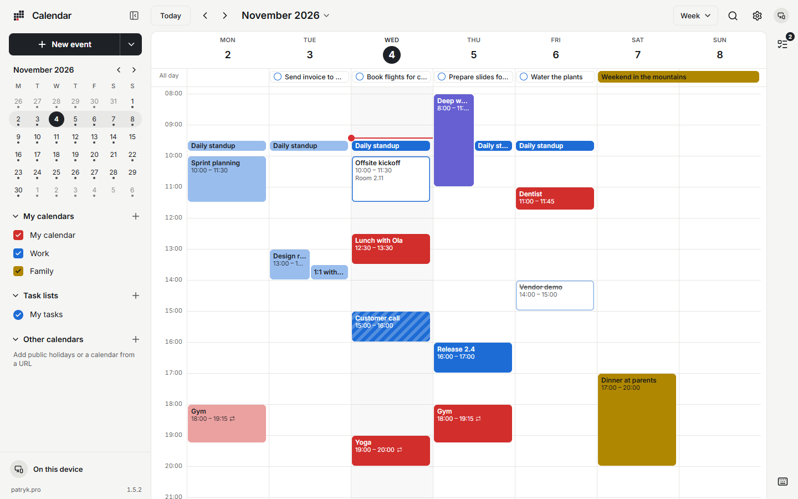
  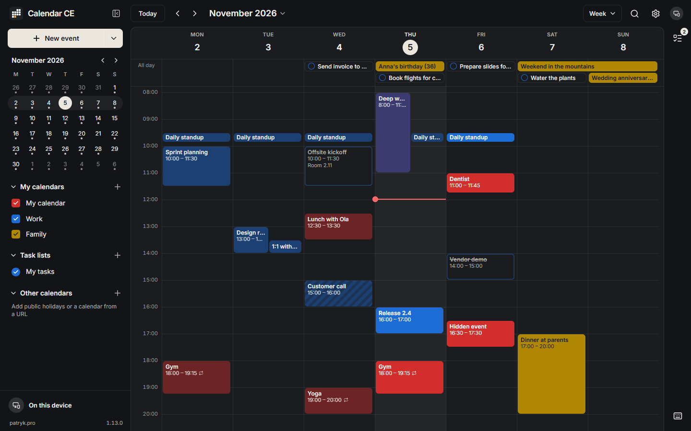
</p>

---

<table>
  <tr>
    <td>
      <b>Try it now, nothing to install.</b> The hosted app at
      <a href="https://calendar.patryk.pro"><b>calendar.patryk.pro</b></a> is the live demo: open it and choose
      <b>On this device</b> to try every feature without an account.<br><br>
      <b>Don't want to run a server?</b> The hosted edition, <b>E2EE Calendar</b>, is the same app plus an
      <b>end-to-end encrypted cloud</b> that keeps your phone, tablet and computer in sync. Nobody but you can read your
      calendar, not even the service. Calendars on the device and on CalDAV servers are free there too; only the
      cloud is paid, after 14 free days (<a href="#community-edition-or-the-hosted-e2ee-calendar">compare</a>). Using
      it supports the development of this free edition.
    </td>
    <td align="center" width="230">
      <a href="https://calendar.patryk.pro"></a>
      <br><br>
      <a href="https://play.google.com/store/apps/details?id=pro.patryk.calendar"></a>
    </td>
  </tr>
</table>

## Contents

- [Features](#features)
- [Community Edition or the hosted E2EE Calendar?](#community-edition-or-the-hosted-e2ee-calendar)
- [How end-to-end encryption works in the hosted edition](#how-end-to-end-encryption-works-in-the-hosted-edition)
- [Self-hosting with Docker](#self-hosting-with-docker)
- [Configuration](#configuration)
- [Behind a reverse proxy](#behind-a-reverse-proxy)
- [Running without Docker](#running-without-docker)
- [Connecting to CalDAV servers](#connecting-to-caldav-servers)
- [Android app](#android-app)
- [Development](#development)
- [Contributing](#contributing)
- [Security](#security)
- [License](#license)

## Features

**Calendar**
- Day, week, month, year and agenda views, plus a custom view of 2–7 days
- Drag to create, move and resize events. On a touch screen, tap to open an event and long-press to pick it up
- Create events in place, or open the full editor for time zones, custom repeat rules, reminders, busy/free and more
- Recurring events: edit or delete *this event*, *this and future events* or *all events*
- Invitations: reply **Yes / Maybe / No** from the event popover
- **Birthdays and anniversaries**: give a birth date or the day it all started, and every view, search and reminder
  shows the years ("Anna's birthday (36)", "10th anniversary")
- **Hidden events**: the eye beside the title keeps an event's name off the screen; views, search and reminders show
  *Hidden event* until you open it
- **Persistent notifications**: an event's or a task's reminder can stay until you dismiss it or mark the task done.
  Completing, deleting or moving the item takes it down too. In a browser it asks to stay on screen where the browser
  allows that; on Android it is pinned (below)
- A one-click **Join** button for Zoom, Teams, Jitsi, Webex and other meeting links
- **Public holidays** for 19 countries, computed on the device (nothing is downloaded)
- Undo for every change, keyboard shortcuts, search that ignores diacritics
- Subscribe to `.ics` / `webcal://` feeds. Import and export `.ics` files

<p align="center">
  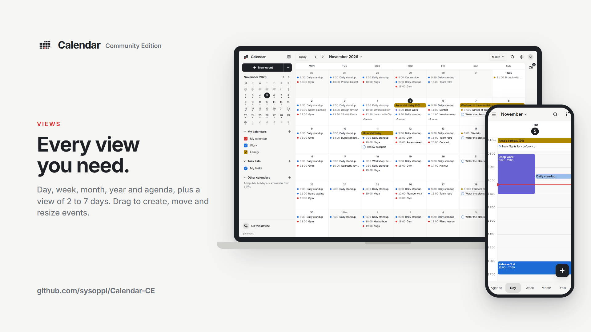
</p>
<p align="center">
  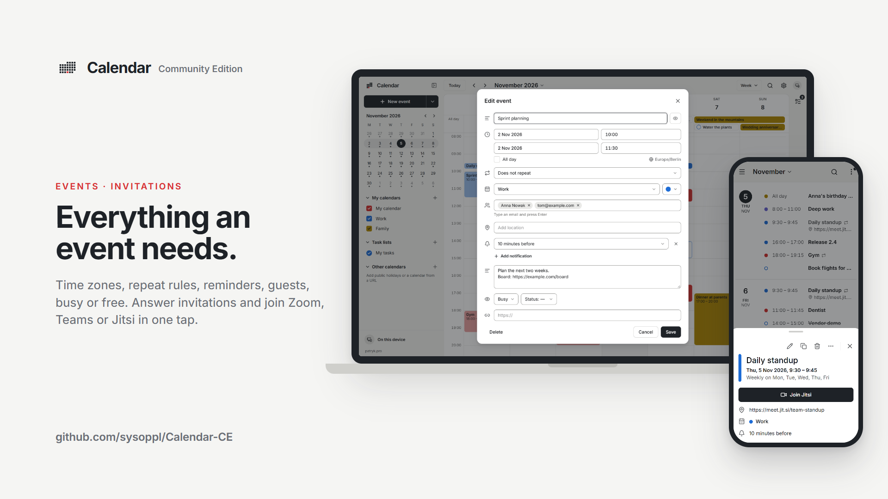
</p>
<p align="center">
  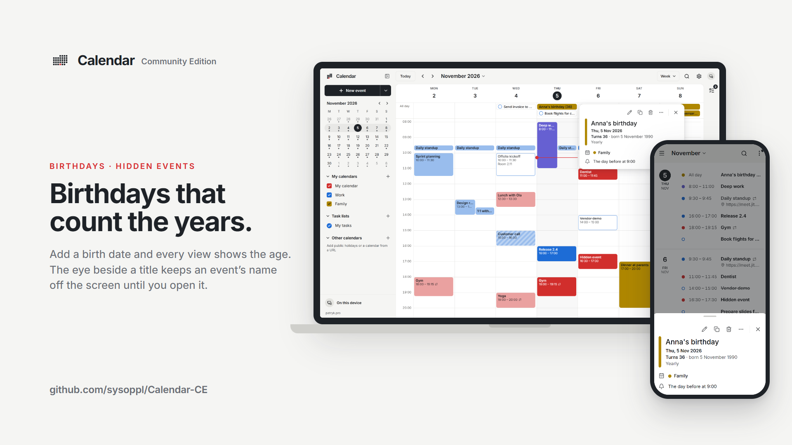
</p>

**Tasks**
- A tasks drawer grouped into Overdue, Today, Tomorrow, Upcoming, No date and Completed
- Quick add with natural-language dates in English and Polish (`Call Anna tomorrow`, `Gym fri`)
- Due dates, priorities, progress, notes, recurrence, reminders and subtasks

<p align="center">
  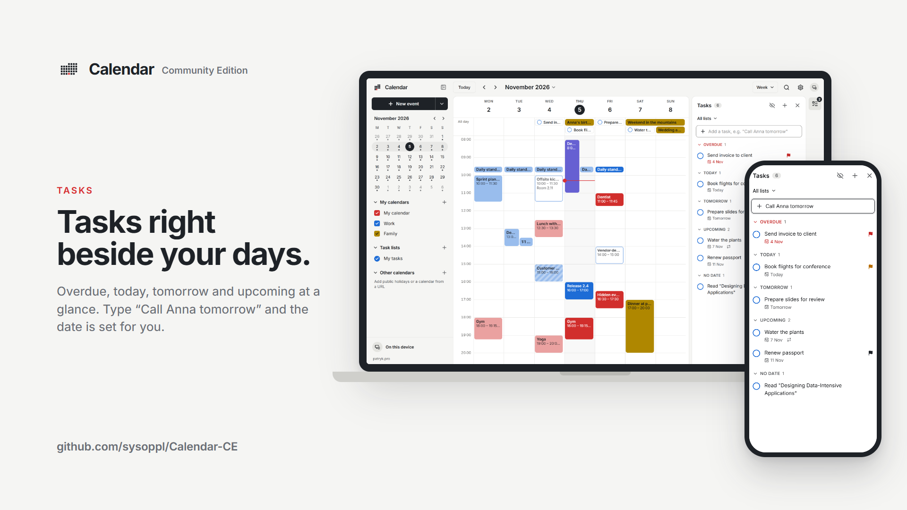
</p>

**Storage**
- **On this device**: no account and no server. Works offline
- **CalDAV**: Nextcloud, Radicale, Baïkal, Fastmail, iCloud, mailbox.org, Posteo, Synology and more. Incremental sync (RFC 6578), conflict-safe writes, creating calendars and task lists
- Use several CalDAV accounts side by side. **Move my data…** copies or moves calendars between places and checks every item before anything is deleted

<p align="center">
  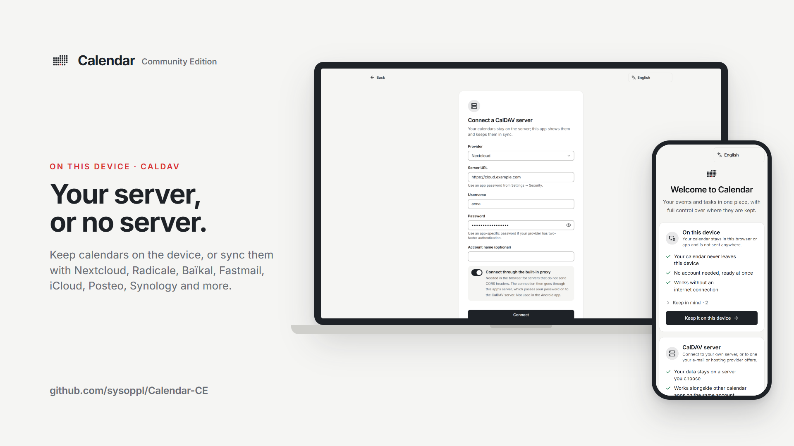
</p>

**Look and languages**
- Five themes (Daylight, Linen, Graphite, Night, High contrast), your own accent colour, four event styles, 12 bundled fonts, two densities and five text sizes
- Interface in English, Polish, German, Spanish, French, Italian, Portuguese (Brazil), Ukrainian, Czech and Dutch

<p align="center">
  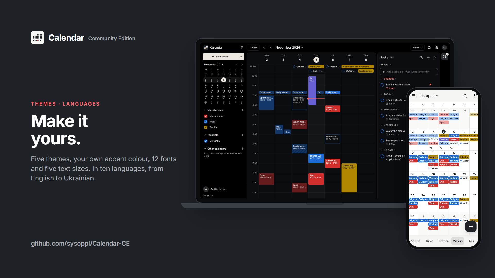
</p>

**Android**
- Native CalDAV client (no proxy, no CORS issues)
- Reminders fire even when the app is closed: exact alarms, rescheduled after a reboot, and CalDAV calendars refreshed hourly in the background
- Persistent notifications stay pinned: a swipe brings one back at once, without a sound, and so do a restart and an
  app update. **Dismiss** and **Snooze 10 min** end it, and a task's **Done** opens the app and marks the task done

<details>
<summary><b>More screenshots</b></summary>
<br>
<p align="center">
  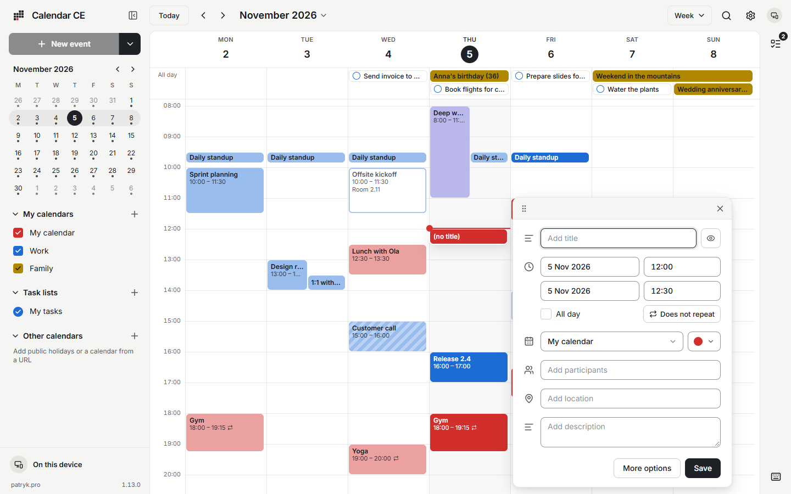
  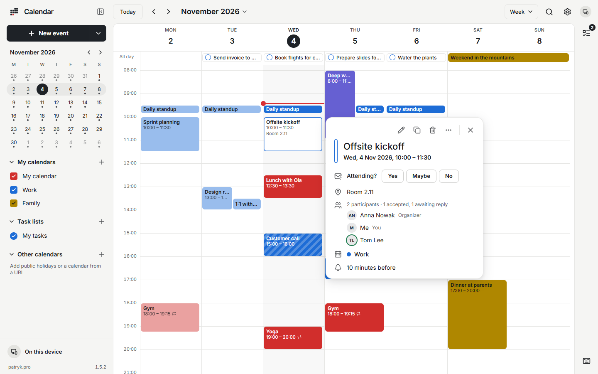
</p>
<p align="center">
  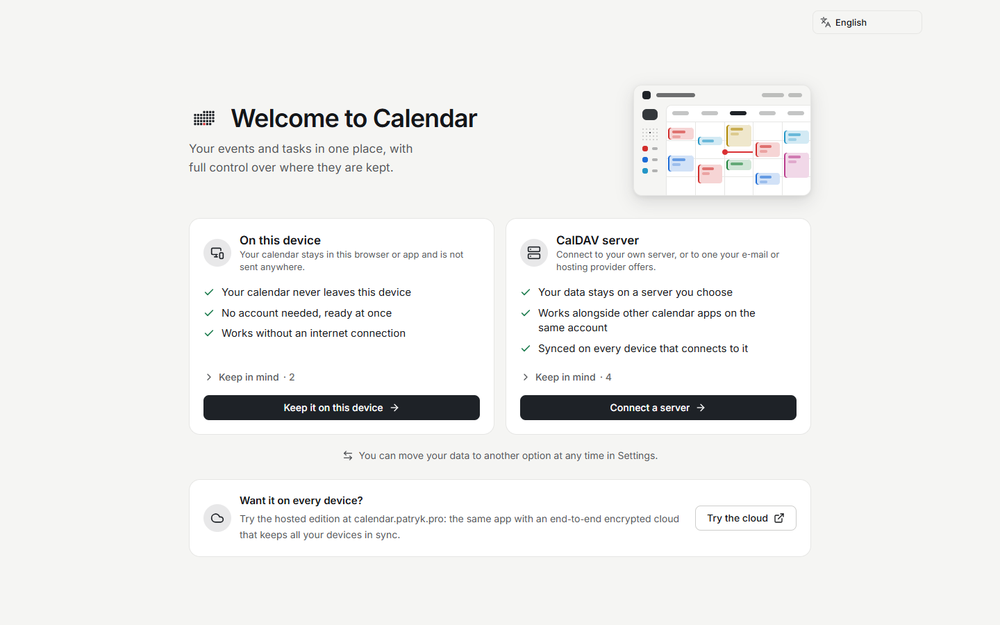
  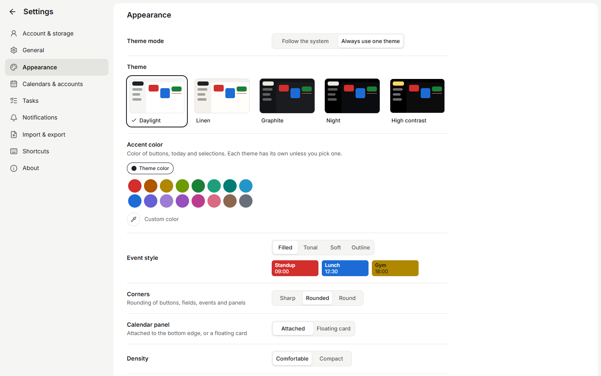
</p>
<p align="center">
  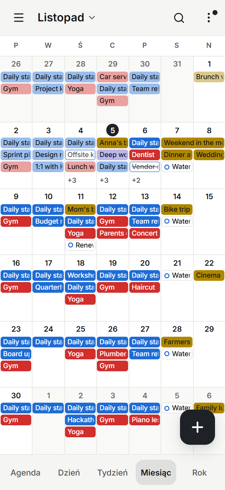
  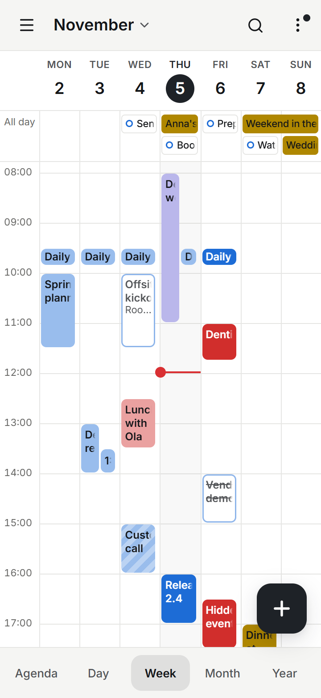
  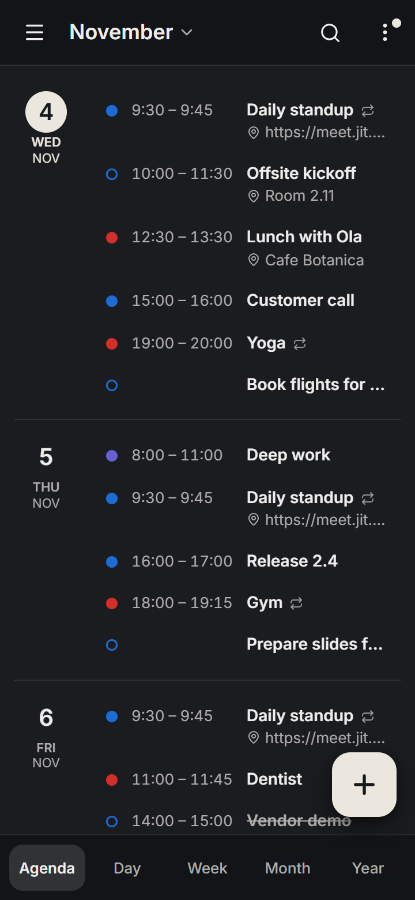
  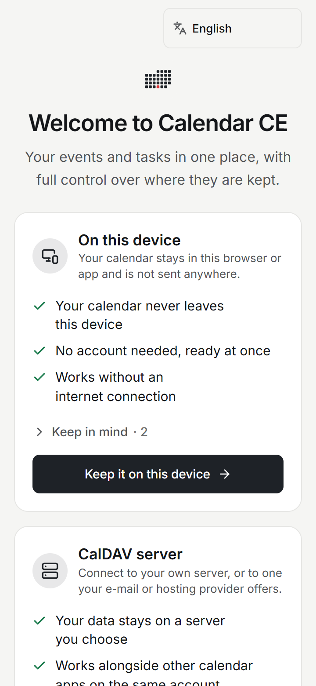
</p>
</details>

## Community Edition or the hosted E2EE Calendar?

Both are the same calendar app. The **Community Edition** is this repository: you run the web app yourself and build
the Android app from it. **[E2EE Calendar](https://calendar.patryk.pro)** is the hosted edition, ready on the web and
on Google Play. It adds an **end-to-end encrypted cloud** that keeps your devices in sync.

**What is free:** in both editions, calendars and tasks **on the device** and on **CalDAV servers**, with no account
and no time limit. **What is paid:** only the hosted edition's cloud, after a **14-day free trial**.

|                                                  | Community Edition (this repo)            | [E2EE Calendar](https://calendar.patryk.pro) (hosted)        |
| ------------------------------------------------ | ---------------------------------------- | ------------------------------------------------------------ |
| Calendars and tasks on the device, no account    | ✓ free                                   | ✓ free                                                       |
| CalDAV accounts (Nextcloud, Radicale, iCloud, …) | ✓ free                                   | ✓ free                                                       |
| End-to-end encrypted cloud that syncs your devices | –                                      | ✓ 14 days free, then a monthly or yearly plan                |
| Settings that follow you to every device         | –                                        | ✓ with the cloud                                             |
| Encrypted profile picture, Recovery Kit          | –                                        | ✓ with the cloud                                             |
| Web app                                          | you host it: [Docker image](#self-hosting-with-docker) or Node | ready at [calendar.patryk.pro](https://calendar.patryk.pro) |
| Android app                                      | you [build it](#android-app) from this repo | [Google Play](https://play.google.com/store/apps/details?id=pro.patryk.calendar) |
| Account                                          | none                                     | only for the cloud: an e-mail address and a password         |
| Ads                                              | none                                     | none on the web. The Google Play app shows one small banner when it is used without a cloud plan; an optional subscription in the app removes it |
| Server to run and update                         | yours                                    | none                                                         |
| Price                                            | free and open source (AGPL-3.0)          | free on the device and with CalDAV; the cloud after its 14-day trial: a monthly or yearly plan |

**How the cloud plan works**

- The trial starts with a new cloud account and lasts 14 days. No payment details are needed for it, and it is given
  once per e-mail address.
- Plans are monthly or yearly, bought in the Android app from Google Play, which shows the price for your country.
  A plan covers every device signed in to the account, the web app included.
- When the trial or a plan ends, the cloud becomes read-only on every device: your calendars stay visible and can
  be exported, or moved to the device or a CalDAV server. Their data is deleted from the server 120 days later, after
  a warning at day 90. A plan bought in the meantime brings writing back at once.
- Calendars on the device and on CalDAV servers are not affected by any of this: they keep working, free, with or
  without a plan.

<p>
  <a href="https://calendar.patryk.pro"></a>
  &nbsp;
  <a href="https://play.google.com/store/apps/details?id=pro.patryk.calendar"></a>
</p>

## How end-to-end encryption works in the hosted edition

The Community Edition never sends your calendar to anyone but the CalDAV server you choose. The hosted
**[E2EE Calendar](https://calendar.patryk.pro)** adds a cloud that syncs your devices, and it's built so that the
cloud can store your calendar **without being able to read it**.

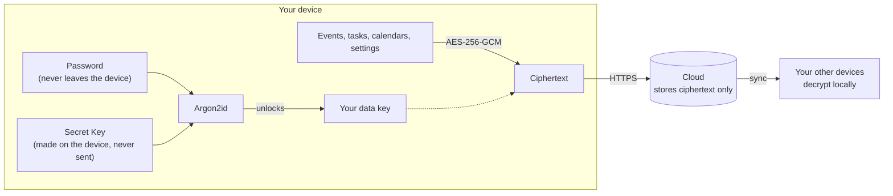

1. **Keys are made on your device.** When you create an account, your device generates a random **Secret Key**. Together
   with your **password** it goes through **Argon2id** (deliberately slow, 64 MiB of memory) to derive the key that
   unlocks your data and a separate secret for signing in. Neither the password nor the Secret Key is ever sent.
2. **Everything is sealed before it leaves.** Calendar names, colours, every event and task (titles, times, repeat
   rules, places, notes, guests, reminders) and all your settings are encrypted with **AES-256-GCM**. Each value is
   bound to where it belongs, so the server can't change an item, move it or slip it into another account without your
   devices noticing.
3. **The cloud only relays ciphertext.** It stores what it gets and passes it between your devices. Someone who
   breaks into its database sees sealed blobs, and because the Secret Key never reached the server, they can't even
   try to guess your password against them.
4. **You keep the way back.** After sign-up you get a **Recovery Kit** (your Secret Key and a Recovery Key) to reset a
   forgotten password. Without the kit and the password, the data can't be opened by anyone, including the service.

| Encrypted on your device | What the service can still see |
| ------------------------ | ------------------------------ |
| Calendar names, colours, descriptions | Your e-mail address (and name, if you give one) |
| Every event and task, in full | How many calendars and items you have, and their approximate sizes |
| All settings, holiday calendars, subscriptions | When items were created, changed or deleted |
| Your profile picture | Your signed-in devices |

**Read the code.** The client-side encryption is published in [`src/lib/crypto/`](src/lib/crypto) with fixed test vectors,
and [`docs/ENCRYPTION.md`](docs/ENCRYPTION.md) specifies it byte for byte. The Community Edition doesn't use it; it's
there so anyone can verify how the hosted cloud protects data.

The hosted web app is loaded from the server at each start, so for the strongest guarantee use the
[Android app](https://play.google.com/store/apps/details?id=pro.patryk.calendar), whose code ships inside the signed APK.

## Self-hosting with Docker

Every release is published as a ready-made image, **`ghcr.io/sysoppl/calendar-ce`**, for `linux/amd64` and
`linux/arm64` (a Raspberry Pi 4/5 or an ARM server works too). There's nothing to build: you need Docker with the
Compose plugin and the [`docker-compose.yml`](docker-compose.yml) of this repository.

| Image tag | What it is                                                                                 |
| --------- | ------------------------------------------------------------------------------------------ |
| `1.11.1`  | One exact release. Recommended on a server: you decide when to update                       |
| `1.11`    | The newest release of the 1.11 line                                                          |
| `1`       | The newest release of version 1                                                             |
| `latest`  | The newest release (the default in `docker-compose.yml`)                                     |

The container holds no data: calendars live in the browser (**On this device**) or on your CalDAV server. Replacing
or removing the container loses nothing, and there's no volume to back up.

### Try it on your computer

```sh
mkdir calendar && cd calendar
curl -fsSLO https://raw.githubusercontent.com/sysoppl/Calendar-CE/main/docker-compose.yml
docker compose up -d
```

Open <http://localhost:8787>. On the welcome screen choose **On this device** or **Connect a server** (CalDAV).

The container serves the web app and a small **DAV proxy** (`/dav-proxy`). Browsers can't talk to most CalDAV servers
directly (no CORS headers), so the web app relays CalDAV requests through it. The proxy stores nothing and is
locked down by default: **it reaches no server until you allow one.** Name the CalDAV hosts your users need in
`docker-compose.yml`, then apply the change with `docker compose up -d`:

```yaml
    environment:
      CALENDAR_PROXY_ALLOW: "cloud.example.com,caldav.fastmail.com"
```

**No CalDAV server at hand?** The compose file includes a [Radicale](https://radicale.org/) demo. Set
`CALENDAR_PROXY_ALLOW: "radicale"`, then:

```sh
docker compose --profile radicale up -d
```

Add an account with server `http://radicale:5232/` and any user name and password (authentication is off in the demo).

### Deploy on a server with HTTPS

You need a Linux server with Docker, a domain name (here `calendar.example.com`) whose DNS record points at it, and
ports 80 and 443 open. The app listens on `127.0.0.1:8787` only, and a reverse proxy on the same server
([Caddy](https://caddyserver.com/) or nginx) handles HTTPS.

1. **Get the compose file:**

   ```sh
   sudo mkdir -p /opt/calendar && cd /opt/calendar
   sudo curl -fsSLO https://raw.githubusercontent.com/sysoppl/Calendar-CE/main/docker-compose.yml
   ```

2. **Set it up.** Edit `/opt/calendar/docker-compose.yml`: pin the release, and in `environment:` set your address,
   the reverse proxy and the CalDAV servers your users may reach:

   ```yaml
       image: ghcr.io/sysoppl/calendar-ce:1.11.1
       ...
       environment:
         VITE_APP_URL: "https://calendar.example.com"
         CALENDAR_TRUST_PROXY: "1"
         CALENDAR_PROXY_ALLOW: "cloud.example.com,caldav.fastmail.com"
         # Optional, shown in the app: VITE_PRIVACY_URL, VITE_TERMS_URL, VITE_CONTACT_URL
   ```

   The `build:` section only matters when you build the image yourself; Compose ignores it otherwise.

3. **Start it**, check that the container reports `healthy`, and read what the server says about its settings when it
   starts (`dav-proxy:` lines):

   ```sh
   sudo docker compose up -d
   sudo docker compose ps
   sudo docker compose logs calendar
   curl -I http://127.0.0.1:8787/
   ```

4. **Put HTTPS in front of it.** With Caddy, which gets the certificate by itself:

   ```sh
   sudo curl -fsSL https://raw.githubusercontent.com/sysoppl/Calendar-CE/main/deploy/Caddyfile -o /etc/caddy/Caddyfile
   sudo sed -i 's/calendar.example.com/your.domain/' /etc/caddy/Caddyfile
   sudo mkdir -p /var/log/caddy && sudo chown caddy:caddy /var/log/caddy
   sudo systemctl reload caddy
   ```

   With nginx, use [`deploy/nginx.conf`](deploy/nginx.conf) and a certificate from certbot instead. See
   [Behind a reverse proxy](#behind-a-reverse-proxy) for what both examples take care of.

5. **Open `https://calendar.example.com`.** Users who choose **On this device** keep their calendar in their own
   browser; those who connect a CalDAV server reach it through the proxy.

### Updating

```sh
cd /opt/calendar
# with a pinned release: change the image tag in docker-compose.yml first
sudo docker compose pull
sudo docker compose up -d
sudo docker image prune -f   # removes the previous image
```

Releases are published on the [releases page](https://github.com/sysoppl/Calendar-CE/releases), with notes of what changed
since the one before and the image to pull. A version is released only after the full test run has passed for its
tag. Every image carries its version and the commit it was built from (`org.opencontainers.image.version` and
`.revision` labels), plus an SBOM and build provenance.

### Without Compose

The same container with `docker run`, locked down like the compose file:

```sh
docker run -d --name calendar --restart unless-stopped \
  -p 127.0.0.1:8787:8787 --read-only --cap-drop ALL --security-opt no-new-privileges:true \
  --memory 512m \
  -e VITE_APP_URL="https://calendar.example.com" \
  -e CALENDAR_TRUST_PROXY="1" \
  -e CALENDAR_PROXY_ALLOW="cloud.example.com" \
  ghcr.io/sysoppl/calendar-ce:1.11.1
```

Update it with `docker pull` of the new tag, then `docker rm -f calendar` and the same `docker run` with that tag.

### Building the image yourself

From a clone of this repository, for example to run a modified version:

```sh
git clone https://github.com/sysoppl/Calendar-CE.git
cd Calendar-CE
docker compose up -d --build
```

The image is tagged like the published one (`ghcr.io/sysoppl/calendar-ce:latest`) on your machine only. If you publish
a modified version, give it your own image name and point the app's **Source code** link at your fork (AGPL-3.0).

## Configuration

Every setting is an environment variable: `environment:` in `docker-compose.yml`, `-e` for `docker run`, or
`/etc/calendar.env` for the systemd unit. A change needs only a restart (`docker compose up -d`), never a rebuild.

**The app:**

| Variable           | Default                 | What it does                                                                                 |
| ------------------ | ----------------------- | -------------------------------------------------------------------------------------------- |
| `VITE_APP_URL`     | `http://localhost:8787` | The public address of your instance. The DAV proxy only answers requests for its host name   |
| `VITE_PRIVACY_URL` | *(empty)*               | Link to your privacy policy, shown in the app. Empty means it isn't shown                    |
| `VITE_TERMS_URL`   | *(empty)*               | Link to your terms of service                                                                |
| `VITE_CONTACT_URL` | *(empty)*               | A contact page or a `mailto:` address                                                        |

`npm run build` reads the same variables, so a build of your own (and the Android app, which has no server) can carry
them too; the server's values take precedence.

**The server and its DAV proxy:**

| Variable                       | Default        | What it does                                                                                                   |
| ------------------------------ | -------------- | -------------------------------------------------------------------------------------------------------------- |
| `CALENDAR_PROXY_ALLOW`         | *(empty)*      | CalDAV hosts the proxy may reach, comma separated, `*.example.com` allowed. Empty means none                   |
| `CALENDAR_PROXY_PRIVATE_HOSTS` | *(empty)*      | Dotted names of your own servers on a private network (e.g. `dav.home.example`)                                |
| `CALENDAR_PROXY_ALLOW_PRIVATE` | `false`        | Let the proxy reach loopback/LAN addresses for every host. Only on a network you trust                         |
| `CALENDAR_PROXY_OPEN`          | `false`        | Let the proxy reach **any** public host while the lists are empty. Only for a server you alone use            |
| `CALENDAR_PROXY_ALLOW_HTTP`    | `false`        | Allow plain `http://` with a password to public addresses                                                       |
| `CALENDAR_PROXY_DISABLED`      | `false`        | Turn the proxy off. CalDAV in the browser then only works with servers that send CORS headers                  |
| `CALENDAR_PUBLIC_HOSTS`        | *(empty)*      | Extra host names this server is reached by, besides the host of `VITE_APP_URL`                                 |
| `CALENDAR_TRUST_PROXY`         | `0`            | Number of reverse proxies in front of the server (usually `1`). Needed for per-client rate limits              |
| `CALENDAR_PROXY_RATE` / `_BURST` / `_CLIENT_CONCURRENCY` / `_CONCURRENCY` | `600` / `300` / `6` / `32` | Request budget of the proxy per client address              |
| `CALENDAR_PROXY_AUTH_FAILURES` | `20`           | Wrong-password answers one client may get in 10 minutes before it's slowed down                                |
| `CALENDAR_PROXY_LOG`           | `true`         | One log line per proxied request (client, method, host, status; never paths or credentials)                    |
| `CALENDAR_HSTS`                | 2 years        | `Strict-Transport-Security` value; `off` removes it                                                            |
| `PORT` / `HOST`                | `8787` / `0.0.0.0` | Where the server listens (use `HOST=127.0.0.1` behind a reverse proxy on the same machine)              |

[`deploy/calendar.env.example`](deploy/calendar.env.example) explains every server setting in more detail.

## Behind a reverse proxy

Ready-made examples are in [`deploy/`](deploy). Both forward to `127.0.0.1:8787`, where the container (or the systemd
service) listens:

- [`Caddyfile`](deploy/Caddyfile): automatic HTTPS
- [`nginx.conf`](deploy/nginx.conf): with a Let's Encrypt certificate

Replace `calendar.example.com` with your own domain, and set `VITE_APP_URL=https://your.domain` and
`CALENDAR_TRUST_PROXY=1` for the app. Both examples allow the DAV proxy's request size (10 MiB) and time (90 s), keep
CalDAV addresses and credentials out of their access logs, and pass the client address on. The server sends its own
security headers (CSP, HSTS and others), so don't add any in the proxy.

## Running without Docker

You need Node.js 24.

```sh
npm ci
VITE_APP_URL=https://calendar.example.com npm run build
VITE_APP_URL=https://calendar.example.com CALENDAR_PROXY_ALLOW=dav.example.com npm start
```

For a permanent install there's a hardened systemd unit in [`deploy/calendar.service`](deploy/calendar.service)
(it runs from `/opt/calendar` with the settings in `/etc/calendar.env`).

## Connecting to CalDAV servers

| Provider          | Server URL                      | Notes                    |
| ----------------- | ------------------------------- | ------------------------ |
| Radicale          | `http://host:5232/`             |                          |
| Nextcloud         | `https://host/remote.php/dav`   | Use an app password      |
| Baïkal            | `https://host/dav.php`          |                          |
| Fastmail          | `https://caldav.fastmail.com/`  | App password required    |
| iCloud            | `https://caldav.icloud.com/`    | App-specific password    |
| mailbox.org       | `https://dav.mailbox.org/`      |                          |
| Posteo            | `https://posteo.de:8443/`       |                          |
| Synology Calendar | `https://nas:5001/caldav/`      |                          |

CalDAV endpoints that only accept OAuth aren't supported. In the browser, remember to add the server's host to
`CALENDAR_PROXY_ALLOW`.

## Android app

The Android app is the same code in a [Capacitor](https://capacitorjs.com/) shell. Its application id is
`pro.patryk.calendar.community`, so it never clashes with the store app. You need JDK 21 and the Android SDK
(Android Studio brings both).

```sh
npm ci
npm run android:sync          # builds the web bundle and copies it into android/
cd android
./gradlew testDebugUnitTest   # unit tests
./gradlew assembleDebug       # app/build/outputs/apk/debug/app-debug.apk
```

A signed release build (`./gradlew assembleRelease`) reads its keystore from the environment (`ANDROID_KEYSTORE_FILE`,
`ANDROID_KEYSTORE_PASSWORD`, `ANDROID_KEY_ALIAS`, `ANDROID_KEY_PASSWORD`) or from a git-ignored
`android/keystore.properties` (`storeFile`, `storePassword`, `keyAlias`, `keyPassword`). Without one, the release APK
is left unsigned.

Prefer a ready-made app? **[Calendar on Google Play](https://play.google.com/store/apps/details?id=pro.patryk.calendar)**.

## Development

```sh
npm ci
npm run dev          # http://localhost:5173, with the DAV proxy built in
npm run typecheck
npm test             # Vitest
npm run build        # production bundle in dist/
```

In development the proxy may reach a CalDAV server on your own machine (e.g. Radicale on `127.0.0.1:5232`).
`window.__calendarSeed()` in the browser console of the dev server fills the calendar with sample data.

| Path               | What's inside                                                        |
| ------------------ | -------------------------------------------------------------------- |
| `src/`             | The React app (TypeScript, Zustand, Tailwind CSS)                    |
| `src/lib/dav/`     | The CalDAV client                                                    |
| `src/lib/ical/`    | iCalendar parsing, recurrence and time zones                         |
| `src/lib/crypto/`  | The hosted edition's end-to-end encryption, published for review     |
| `src/i18n/`        | The 10 interface languages                                           |
| `server/`          | The zero-dependency Node server and the DAV proxy                    |
| `android/`         | The Android shell, native CalDAV client and reminders                |
| `deploy/`          | Reverse proxy and systemd examples                                   |
| `scripts/`         | Build helpers, screenshots, end-to-end checks                        |

## Contributing

Contributions are welcome: bug reports, translations, fixes and features that fit a local-first calendar.

1. Open an [issue](https://github.com/sysoppl/Calendar-CE/issues) first for anything bigger than a small fix, so we can agree on the approach.
2. Fork the repo and create a branch from `main`.
3. Keep changes focused, add tests for new behaviour, and make sure `npm run typecheck`, `npm test` and `npm run build` pass.
4. New interface text goes into `src/i18n/en.ts` **and** every other language (the tests check that all 10 have the same keys).
5. New dependencies must have a licence compatible with the AGPL-3.0; run `npm run licenses` to update the third-party notices.
6. Open a pull request describing what changed and why.

Before your first pull request is merged, the CLA Assistant bot asks you to sign the
[Contributor License Agreement](CLA.md) once. You keep the copyright in your work; the agreement lets the maintainer
also use it in other editions of Calendar, such as the hosted one, and keeps everything merged here open source.

## Security

Please don't report security issues in public issues. See [SECURITY.md](SECURITY.md).

## License

Copyright © 2026 [patryk.pro](https://patryk.pro).

Calendar Community Edition is free software: you can redistribute it and/or modify it under the terms of the
[GNU Affero General Public License, version 3 only](LICENSE) (AGPL-3.0-only). It comes without any warranty. If you
run a modified version for other people over a network, you must offer them its source code (the app's
**Settings → About → Source code** link points at the release it was built from; point it at your fork). Third-party
components keep their own licences, listed in [`public/THIRD-PARTY-NOTICES.txt`](public/THIRD-PARTY-NOTICES.txt).

**The Docker image** contains this app (its licence is `/app/LICENSE`, the third-party notices are
`/app/dist/THIRD-PARTY-NOTICES.txt`) on top of the official [`node:24-alpine`](https://hub.docker.com/_/node) image,
which brings Node.js, npm and Alpine Linux packages, each under its own licence. Their sources:
[Node.js](https://github.com/nodejs/node) (the version `node --version` prints), the
[image definition](https://github.com/nodejs/docker-node) and [Alpine's aports](https://gitlab.alpinelinux.org/alpine/aports)
(the branch matching `/etc/alpine-release`). Every published image lists its packages and their licences in an SBOM:
`docker buildx imagetools inspect ghcr.io/sysoppl/calendar-ce:1.11.1 --format '{{ json .SBOM }}'`.

**Names.** The AGPL-3.0 grants no rights to the names *patryk.pro* and *E2EE Calendar* or to the Calendar icon as
marks: please give a build you publish a name and icon of your own. Other product names belong to their owners and are
only used to name the services Calendar works with. Google Play and the Google Play logo are trademarks of Google LLC.

<p align="center">
  Made by <a href="https://patryk.pro">patryk.pro</a> · Hosted edition: <a href="https://calendar.patryk.pro"><b>calendar.patryk.pro</b></a>
</p>
